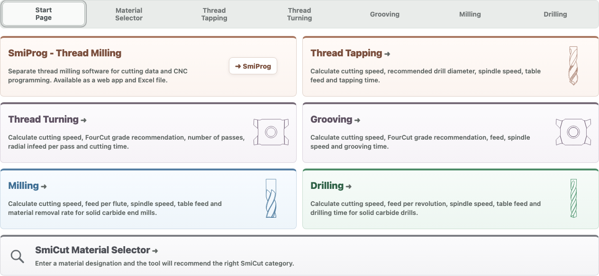

<h1> SmiCalc</h1>

**Free cutting-data calculators. Choose your language, open the app and start calculating.**

[**Use online**](https://smicut.com/en/smicalc-cutting-data-calculator/) · [**Download in your language**](#choose-your-language) · [**Adapt for your company**](REBRANDING.md)

SmiCalc helps you calculate cutting data and estimate machining times for thread
tapping, thread turning, grooving, solid carbide milling and drilling. Made by
[SmiCut](https://smicut.com). Free to use and adapt, including commercial use.

Use the same complete HTML file on your own website: paste its contents into a
Raw HTML block. [Website installation guide](docs/website-embedding.md).

## Choose your language

Use the online version immediately, or download **one HTML file** for your computer.
No GitHub account, installation or programming knowledge is needed to use it.
There are 20 language and market editions:

<!-- BEGIN LANGUAGE TABLE -->
| Language | Use online | Download HTML |
|---|---|---|
| Bahasa Indonesia | [Open SmiCalc](https://smicut.com/id/smicalc-kalkulator-cutting-data/) | [Download](https://github.com/SmiCut/smicalc/releases/latest/download/smicalc-id.html) |
| Dansk | [Open SmiCalc](https://smicut.com/da/smicalc-beregner-til-skaeredata/) | [Download](https://github.com/SmiCut/smicalc/releases/latest/download/smicalc-da.html) |
| Deutsch | [Open SmiCalc](https://smicut.com/de/smicalc-schnittdatenrechner/) | [Download](https://github.com/SmiCut/smicalc/releases/latest/download/smicalc-de.html) |
| English – Global | [Open SmiCalc](https://smicut.com/en/smicalc-cutting-data-calculator/) | [Download](https://github.com/SmiCut/smicalc/releases/latest/download/smicalc-en.html) |
| English – South Africa | [Open SmiCalc](https://smicut.com/en-za/smicalc-cutting-data-calculator-2/) | [Download](https://github.com/SmiCut/smicalc/releases/latest/download/smicalc-en-za.html) |
| Español – Global | [Open SmiCalc](https://smicut.com/es-gl/smicalc-calculadora-de-datos-de-corte-2/) | [Download](https://github.com/SmiCut/smicalc/releases/latest/download/smicalc-es-gl.html) |
| Español – España | [Open SmiCalc](https://smicut.com/es/smicalc-calculadora-de-datos-de-corte/) | [Download](https://github.com/SmiCut/smicalc/releases/latest/download/smicalc-es.html) |
| Français – Global | [Open SmiCalc](https://smicut.com/fr/smicalc-calculateur-de-donnees-de-coupe/) | [Download](https://github.com/SmiCut/smicalc/releases/latest/download/smicalc-fr.html) |
| Français – Belgique | [Open SmiCalc](https://smicut.com/fr-be/smicalc-calculateur-de-donnees-de-coupe-2/) | [Download](https://github.com/SmiCut/smicalc/releases/latest/download/smicalc-fr-be.html) |
| Italiano | [Open SmiCalc](https://smicut.com/it/smicalc-calcolatore-dei-dati-di-taglio/) | [Download](https://github.com/SmiCut/smicalc/releases/latest/download/smicalc-it.html) |
| Magyar | [Open SmiCalc](https://smicut.com/hu/smicalc-forgacsolasi-adatok-kalkulatora/) | [Download](https://github.com/SmiCut/smicalc/releases/latest/download/smicalc-hu.html) |
| Nederlands – België | [Open SmiCalc](https://smicut.com/nl-be/smicalc-snijgegevenscalculator/) | [Download](https://github.com/SmiCut/smicalc/releases/latest/download/smicalc-nl-be.html) |
| Nederlands – Nederland | [Open SmiCalc](https://smicut.com/nl/smicalc-snijgegevenscalculator-2/) | [Download](https://github.com/SmiCut/smicalc/releases/latest/download/smicalc-nl.html) |
| Polski | [Open SmiCalc](https://smicut.com/pl/smicalc-kalkulator-parametrow-skrawania/) | [Download](https://github.com/SmiCut/smicalc/releases/latest/download/smicalc-pl.html) |
| Svenska | [Open SmiCalc](https://smicut.com/sv/smicalc-berakningsverktyg-for-skardata/) | [Download](https://github.com/SmiCut/smicalc/releases/latest/download/smicalc-sv.html) |
| Русский | [Open SmiCalc](https://smicut.com/ru/smicalc-%d0%ba%d0%b0%d0%bb%d1%8c%d0%ba%d1%83%d0%bb%d1%8f%d1%82%d0%be%d1%80-%d1%80%d0%b5%d0%b6%d0%b8%d0%bc%d0%be%d0%b2-%d1%80%d0%b5%d0%b7%d0%b0%d0%bd%d0%b8%d1%8f/) | [Download](https://github.com/SmiCut/smicalc/releases/latest/download/smicalc-ru.html) |
| 简体中文 | [Open SmiCalc](https://smicut.com/zh/smicalc-%e5%88%87%e5%89%8a%e5%8f%82%e6%95%b0%e8%ae%a1%e7%ae%97%e5%99%a8/) | [Download](https://github.com/SmiCut/smicalc/releases/latest/download/smicalc-zh.html) |
| 繁體中文 | [Open SmiCalc](https://smicut.com/zh-tw/smicalc-%e5%88%87%e5%89%8a%e5%8f%83%e6%95%b8%e8%a8%88%e7%ae%97%e5%99%a8/) | [Download](https://github.com/SmiCut/smicalc/releases/latest/download/smicalc-zh-tw.html) |
| 日本語 | [Open SmiCalc](https://smicut.com/ja/%e3%82%b9%e3%83%9f%e3%82%ab%e3%83%ab%e3%82%af-%e5%88%87%e5%89%8a%e6%9d%a1%e4%bb%b6%e8%a8%88%e7%ae%97%e3%83%84%e3%83%bc%e3%83%ab/) | [Download](https://github.com/SmiCut/smicalc/releases/latest/download/smicalc-ja.html) |
| 한국어 | [Open SmiCalc](https://smicut.com/ko/smicalc-%ec%a0%88%ec%82%ad-%eb%8d%b0%ec%9d%b4%ed%84%b0-%ea%b3%84%ec%82%b0%ea%b8%b0/) | [Download](https://github.com/SmiCut/smicalc/releases/latest/download/smicalc-ko.html) |
<!-- END LANGUAGE TABLE -->

[Download all languages in one ZIP](https://github.com/SmiCut/smicalc/releases/latest/download/smicalc-apps.zip) · [Latest release and changes](https://github.com/SmiCut/smicalc/releases/latest)

## Open your download in three steps

1. Choose **Download** next to your language above.
2. Find the downloaded `.html` file in your Downloads folder.
3. Double-click it to open SmiCalc in your web browser. If asked, choose a browser.

If you chose the all-language ZIP, extract it first, then open the HTML file for
your language. The included `START-HERE.txt` lists every filename and language.
You can keep the HTML file on your computer and use the calculators without internet.
Choose the material category manually when working offline.

**The AI Material Selector needs internet and an approved website.** Opening the
downloaded file on your computer does not enable the hosted AI service. Use SmiCalc
online for that feature, or [request access for your own website](MATERIAL_SELECTOR.md).

Need more help? See [opening, updating and using SmiCalc on your website](docs/getting-started.md).

## Make it your own

You may use your own company name, logo, colours and links, change the program,
and offer your version to customers, including commercially. Your changes can stay private.

There is no built-in branding editor. Changing the app requires editing its HTML,
CSS or JavaScript; a web developer can help. Keep the included copyright and MIT
license notice in the file. It does not need to appear visibly in your interface.

[**Read the simple customization guide**](REBRANDING.md) · [**Put SmiCalc on your website**](docs/getting-started.md#use-smicalc-on-your-website)

## Help and further information

[Browse the documentation](docs/README.md)

- **Using SmiCalc:** email [info@smicut.se](mailto:info@smicut.se).
- **AI access for your website:** follow the [Material Selector guide](MATERIAL_SELECTOR.md).
- **Report a problem or suggest an improvement:** [open an issue](https://github.com/SmiCut/smicalc/issues).
- **For developers:** [source files, tests and localization](docs/development.md), [contributing](.github/CONTRIBUTING.md), and [MIT license](LICENSE).
- **Thread milling and CNC programs:** see [SmiProg](https://github.com/SmiCut/smiprog).

Cutting data are starting recommendations. Check them for your tool, material,
machine and setup before machining.

For contributors: [what belongs in this public project](docs/publication-policy.md).
